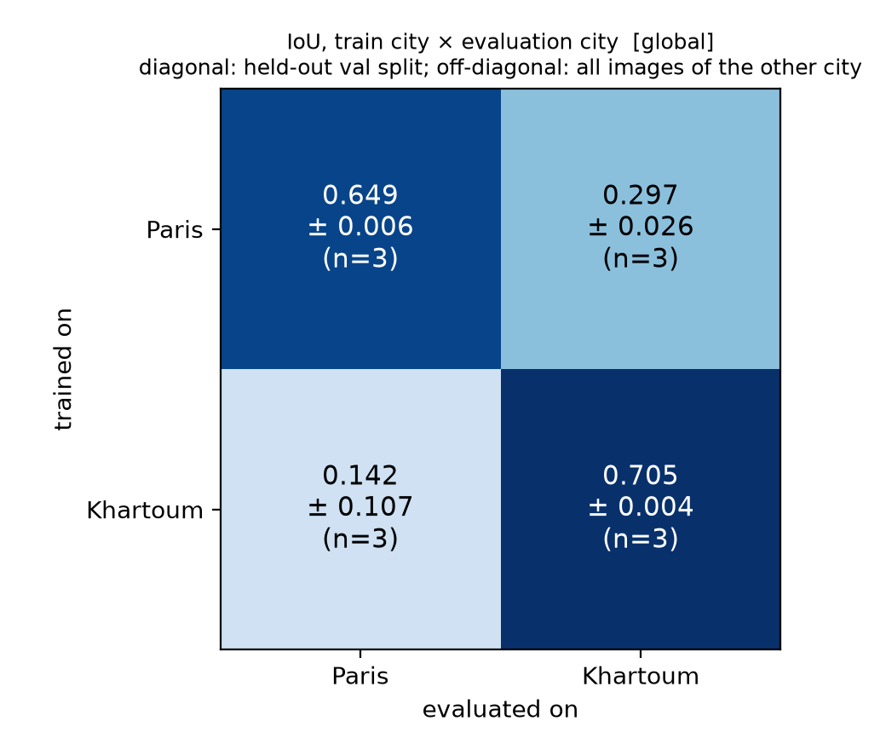
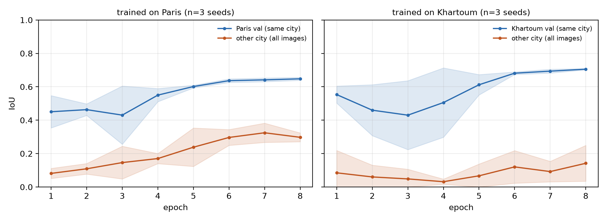
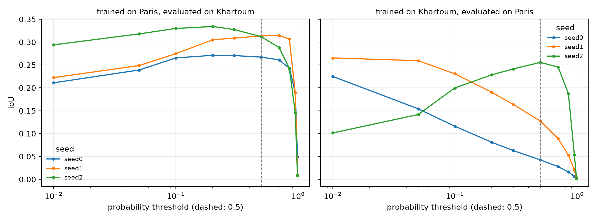
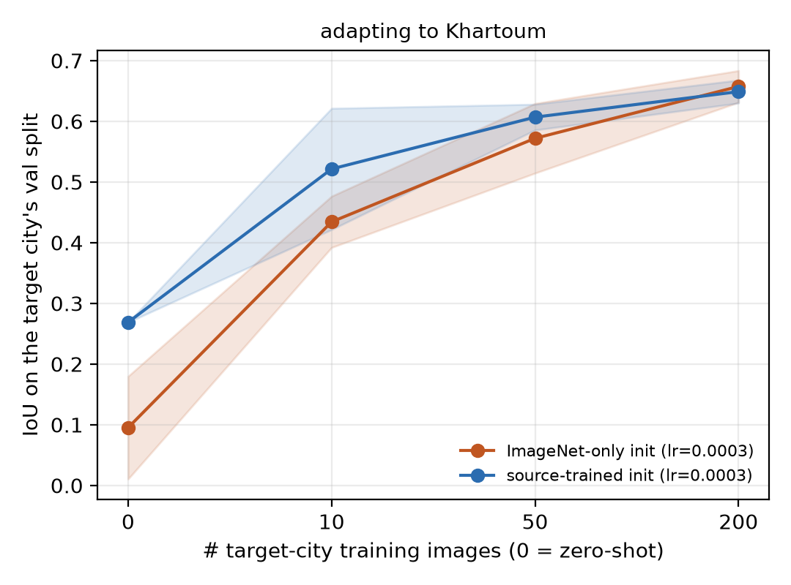

# Cross-city building segmentation

How well does a U-Net that segments buildings in one city work in another?
This repo trains a U-Net on **SpaceNet-2** satellite tiles of **Paris** and
**Khartoum**, measures in-city vs. cross-city IoU over several seeds, and provides
tools to diagnose *why* performance drops (calibration, normalization, few-shot adaptation).

> **Status.** Three experiments are done and summarized below: two-city transfer
> (2 cities x 3 seeds), a threshold-sweep diagnosis of the 6 trained models, and few-shot
> adaptation Paris -> Khartoum (source-trained vs. ImageNet-only init, 3 seeds). Raw results are in
> `results/runs/` and `results/sweeps/`. Open items: few-shot in the other direction, and the
> normalization / brightness ablations with seeds (see *Next steps*).

## Questions

1. How much IoU is lost when a model trained on one city is applied to the other (both directions)?
2. Is the loss a calibration problem (the model's probabilities shift) or a loss of ranking ability? (threshold sweep: it depends on the direction)
3. Can per-image normalization or brightness augmentation close the gap? (exploratory so far)
4. How many labelled images from the new city are needed to recover, and does starting from the source-city model beat starting from ImageNet alone? (Paris -> Khartoum only: ~10 images roughly double the IoU; the source init helps most at 10 images and not at all by 200)

## Data

SpaceNet-2 (building footprints), Paris (`AOI_3`, 1148 tiles) and Khartoum
(`AOI_5`, 1012 tiles). Each tile is 650x650, 3-band `uint16` pan-sharpened RGB with
a GeoJSON of building polygons. Both are on a public S3 bucket, no AWS account
needed (about 5.3 GB in total):

```bash
pip install awscli
bash scripts/download_data.sh data        # -> data/AOI_3_Paris, data/AOI_5_Khartoum
```

Building pixels make up **7.3% of Paris** and **15.8% of Khartoum** val-split pixels
(6.9% / 16.3% over all tiles), so the two cities also differ in class balance.
Check the SpaceNet dataset page for its licence terms. The data is not part of this repo.

## Quick start

```bash
pip install -r requirements.txt
python -m pytest -q tests                  # ~15 s, synthetic data, no GPU or download needed

# one run: train on Paris, evaluate on Paris val and on all of Khartoum
python scripts/train.py --train-city paris --seed 0

# the whole grid: training, threshold sweeps, few-shot, figures (resumable)
bash scripts/run_all.sh
```

On Google Colab:

```python
!git clone https://github.com/mmyjw48-web/cross-city-building-segmentation
%cd cross-city-building-segmentation
!pip install -q -r requirements.txt
!bash scripts/download_data.sh /content/data
# put checkpoints on Drive so a disconnect does not lose them (mount Drive first)
!DATA=/content/data OUT=/content/drive/MyDrive/ccbs_runs bash scripts/run_all.sh
```

One 8-epoch run took 20-35 minutes on a Colab T4 (135-250 s per epoch depending on the
session, including the per-epoch evaluation on the other city). Training is resumable:
re-running a command continues from `last.pt`.

### Scripts

| script | purpose |
|---|---|
| `scripts/train.py` | train on one city; evaluate on same-city val and on the other city; writes `result.json` |
| `scripts/evaluate.py` | evaluate a checkpoint on any city/split; `--sweep` adds an IoU-vs-threshold sweep |
| `scripts/run_sweeps.sh` | threshold sweep of every checkpoint on the other city |
| `scripts/few_shot.py` | fine-tune on N target-city images (source init or ImageNet-only control) |
| `scripts/visualize.py` | image / truth / probability / error map for random tiles |
| `scripts/make_figures.py` | aggregate `results/` into figures and `results/summary.md` |
| `scripts/run_all.sh` | the full experiment grid |

Useful flags for `train.py`: `--norm {global,zscore}`, `--aug-brightness`, `--epochs`, `--seed`, `--no-pretrained` (offline), `--max-images` (quick tests).

## Method

- **Input.** `clip(x / 2000, 0, 1)` (a fixed constant for all images; raw values peak around 1800). The `zscore` variant standardizes each channel of each image, ignoring all-zero no-data pixels.
- **Masks.** GeoJSON polygons are reprojected from lon/lat to the image CRS and rasterized onto the image grid (`rasterio`). An empty GeoJSON gives an all-zero mask.
- **Model.** `segmentation_models_pytorch.Unet` with a ResNet-34 encoder (ImageNet weights), 1 output logit per pixel.
- **Loss.** BCE + Dice on logits. Buildings are a minority of pixels, so Dice keeps the model from settling on "mostly background".
- **Training.** Adam, lr 1e-3, cosine decay, batch size 4, 8 epochs, random horizontal/vertical flips (applied per batch).
- **Splits.** Fixed random 80/20 split of each city (seed 42), *independent of the training seed*, so seed-to-seed variation reflects training noise only. Paris: 919 train / 229 val. Khartoum: 810 train / 202 val.
- **Model selection.** Best epoch by **same-city** validation IoU. The other city is monitored every epoch for reporting only and never used to choose a checkpoint.
- **Metrics.** Dataset-level IoU, precision and recall (pixel counts summed over the whole set, then divided), plus predicted vs. true building fraction, at threshold 0.5. Averaging per-image IoU would let empty tiles dominate.
- **Cross-city number.** Evaluated on *all* images of the other city (none were used for training).
- **Threshold sweep.** IoU of each trained model on all images of the other city at thresholds 0.01, 0.05, 0.1, 0.2, 0.3, 0.5, 0.7, 0.85, 0.95, 0.99. The "best threshold" is picked *with the evaluation labels* (an oracle), so it is a diagnostic, not a deployable result.
- **Few-shot.** Fine-tune on N random images from the target city's train split, then evaluate on its val split. The source-trained model and the ImageNet-only control use the **same** learning rate (3e-4), batch size (4) and number of epochs (10); for a given seed and N they also see the **same images**. Subsets are nested within a seed (the N=10 images are among the N=50 ones). The number of gradient steps grows with N (30, 130, 500 for N = 10, 50, 200). The source init is always the Paris seed-0 checkpoint.

## Results: two-city transfer (3 seeds)

8 epochs, global normalization, ImageNet-initialized ResNet-34 U-Net, mean ± std over seeds 0-2
(Tesla T4). Full tables: [`results/summary.md`](results/summary.md); raw runs: `results/runs/`.

| trained on | IoU, same city (val split) | IoU, other city (all tiles) |
|---|---|---|
| Paris | 0.649 ± 0.006 | 0.297 ± 0.026 |
| Khartoum | 0.705 ± 0.004 | 0.142 ± 0.107 |




Per-run numbers, which the averages hide (`pred / true` = fraction of the other city's pixels
predicted / labelled as building at threshold 0.5):

| run | IoU same city | IoU other city | precision | recall | other city: pred / true |
|---|---|---|---|---|---|
| paris, seed 0 | 0.643 | 0.267 | 0.364 | 0.500 | 0.224 / 0.163 |
| paris, seed 1 | 0.653 | 0.313 | 0.349 | 0.753 | 0.352 / 0.163 |
| paris, seed 2 | 0.653 | 0.312 | 0.595 | 0.396 | 0.108 / 0.163 |
| khartoum, seed 0 | 0.701 | 0.042 | 0.724 | 0.043 | 0.004 / 0.069 |
| khartoum, seed 1 | 0.708 | 0.128 | 0.635 | 0.138 | 0.015 / 0.069 |
| khartoum, seed 2 | 0.707 | 0.256 | 0.313 | 0.584 | 0.129 / 0.069 |

What the data show:

- **Same-city IoU is stable** across seeds (std <= 0.006) and the models are well calibrated there (e.g. Khartoum val: 17.1% of pixels predicted vs. 15.8% true).
- **Cross-city IoU is much lower**: 0.649 -> 0.297 (Paris to Khartoum) and 0.705 -> 0.142 (Khartoum to Paris).
- **Cross-city results are unstable in a specific way.** At threshold 0.5 the *amount* of building the model predicts on the new city varies enormously between seeds: a Khartoum-trained model labels 0.4%, 1.5% or 12.9% of Paris pixels as building (true: 6.9%), with IoU 0.04, 0.13 and 0.26. A single IoU at a fixed threshold therefore mixes two things, how well pixels are *ranked* and how well the probabilities are *calibrated* on the new city. The threshold sweep below separates the two.
- **Direction asymmetry is only suggestive.** At threshold 0.5, Paris to Khartoum (0.267-0.313) looks better than Khartoum to Paris (0.042-0.256), but with three seeds the ranges nearly touch (0.267 vs. 0.256). At the oracle thresholds (sweep below) the ranges separate (0.271-0.334 vs. 0.225-0.265), which fits a real asymmetry, but that is still three seeds, with oracle thresholds, and the cities also differ in class balance.
- **The other-city score of a single run is noisy from epoch to epoch** (see the curves), so choosing the epoch by same-city validation IoU does not control cross-city quality.
- The two cities also differ in class balance (7% vs. 16% building pixels), so part of the shift is a change in label prior, not only in appearance. This repo does not separate the two.

## Results: is it calibration? (threshold sweep)

Each trained model, evaluated on all images of the other city, with the threshold varied
(`results/sweeps/`, figure below). The best threshold is an **oracle** (chosen with the evaluation
labels), so these numbers show what is *possible* with a better threshold, not what a user could get.

| trained on -> evaluated on | seed | IoU @ 0.5 | best threshold | IoU @ best |
|---|---|---|---|---|
| Paris -> Khartoum | 0 | 0.267 | 0.2 | 0.271 |
| Paris -> Khartoum | 1 | 0.313 | 0.7 | 0.315 |
| Paris -> Khartoum | 2 | 0.312 | 0.2 | 0.334 |
| Khartoum -> Paris | 0 | 0.042 | 0.01 | 0.225 |
| Khartoum -> Paris | 1 | 0.127 | 0.01 | 0.265 |
| Khartoum -> Paris | 2 | 0.256 | 0.5 | 0.256 |



The `@ 0.5` column re-evaluates the saved best checkpoints and matches the training-time numbers to within 0.0002 (the 0.128 vs. 0.127 for Khartoum seed 1 is rounding of 0.1276 vs. 0.1275).

- **Paris -> Khartoum: threshold is not the problem.** IoU is nearly flat around 0.5 and the best threshold gains at most 0.022 (mean 0.297 -> 0.307). The loss from 0.649 in-city to about 0.3 persists at any threshold, so here the model's *ranking* of pixels is what degrades.
- **Khartoum -> Paris: most of the seed-to-seed instability is threshold / calibration.** At 0.5 the three seeds scored 0.042, 0.127 and 0.256 (mean 0.142 ± 0.107); at their best thresholds they score 0.225, 0.265 and 0.256 (mean 0.249 ± 0.021). Seeds 0 and 1 are far too conservative on Paris (they label 0.4% and 1.5% of pixels as building at 0.5; true: 6.9%) and need a very low threshold.
- **Even after the oracle fix, Khartoum -> Paris reaches only about 0.25**, versus 0.705 in-city, so there is a real ranking/appearance loss as well. Two of the three best thresholds are 0.01, the lowest value in the grid, so the true optimum for those seeds may be lower still and their best IoU slightly higher (not tested).
- Taken together, the two directions fail differently, and a single fixed-threshold IoU hides this. Three seeds per direction are too few to say how general that is.

## Results: few-shot adaptation (Paris -> Khartoum)

Fine-tune on N Khartoum training images, evaluate on the Khartoum val split (202 tiles).
10 epochs, lr 3e-4 for both initializations, mean ± std over 3 seeds (A100); per-seed values in `results/runs/fewshot_khartoum_*.json`.
"source-trained" starts from the Paris seed-0 model, "ImageNet-only" from an ImageNet encoder with a random decoder.

| N Khartoum images | source-trained init | ImageNet-only init | paired difference per seed (source - ImageNet) |
|---|---|---|---|
| 0 | 0.269 (one checkpoint) | 0.095 ± 0.085 (untrained decoder) | not meaningful |
| 10 | 0.521 ± 0.100 | 0.434 ± 0.042 | +0.166, -0.064, +0.160 |
| 50 | 0.607 ± 0.021 | 0.572 ± 0.057 | +0.039, -0.005, +0.070 |
| 200 | 0.649 ± 0.019 | 0.657 ± 0.026 | -0.012, -0.041, +0.028 |



- **A handful of labelled target images goes a long way.** The source-trained model goes from 0.269 (no adaptation) to 0.521 with 10 images and 0.649 with 200. For reference, models trained on all 810 Khartoum training images score 0.705 ± 0.004 (different schedule, so only a rough yardstick).
- **Starting from the source-city model helps mainly in the smallest-data regime, and the evidence is weak.** At N = 10 it is ahead by 0.087 on average, but in one of three seeds it is behind (-0.064); at N = 50 the average edge is 0.035 with one negative seed; at N = 200 the two initializations are indistinguishable (-0.008). With three seeds this is a trend, not a demonstrated effect.
- **The N = 0 row of the ImageNet-only control is not a baseline.** Its decoder is random, so it predicts anything from 0.2% to 79% of pixels as building. It is shown only to complete the curve.

### Reproducibility note

Seeds do not make GPU runs bit-exact. In a repeated run of the same commands (console logs, not archived in
`results/`) the same seed gave the same same-city IoU to within 0.002 but different other-city IoU:
Paris seed 0: 0.267 vs. 0.242; Khartoum seed 0: 0.042 vs. 0.046; Khartoum seed 1: 0.128 vs. 0.077.
So differences of a few IoU points on the other city are within run-to-run noise.

## Exploratory notebook results (single unseeded runs)

From the original Colab notebook; details and provenance in [`results/notebook_runs.json`](results/notebook_runs.json).
These used a different setup (the 5-epoch baseline had no learning-rate decay), so they are **not comparable**
to the table above.

| run | Paris val IoU | Khartoum IoU |
|---|---|---|
| Paris-trained, global norm, 5 epochs | 0.501 | 0.360 |
| Paris-trained, per-image z-score | 0.649 | 0.257 |

Qualitative observations from the notebook, not re-verified with seeds: test-time brightness matching and
brightness augmentation did not improve Khartoum IoU (the brightness-augmented model produced near-empty
predictions there), and z-score normalization raised same-city IoU without helping transfer. `--norm zscore`
and `--aug-brightness` are implemented in `scripts/train.py` to repeat these with seeds.

## Limitations

- **Spatial leakage in the in-city split.** Tiles are cut from larger scenes, so a random train/val split puts adjacent tiles of the same area on both sides. Same-city val IoU is therefore probably optimistic. Cross-city IoU is not affected, but the *gap* may be overstated.
- **Two cities, one sensor, one resolution.** Nothing here says how the findings carry over to other cities, sensors or ground sampling distances.
- **Three seeds.** Enough to see that cross-city IoU is unstable, not enough for tight confidence intervals or for the direction asymmetry. Run-to-run GPU nondeterminism (above) adds noise on top of seed variation.
- **Fixed threshold 0.5** for the headline IoUs. The oracle best-threshold numbers use evaluation labels and are diagnostic only; a deployable version would need a threshold chosen without target labels (for example from a few labelled target images). The sweep grid stops at 0.01, which two Khartoum -> Paris models hit.
- **Few-shot scope.** One direction only (Paris -> Khartoum); one source checkpoint (Paris seed 0); three seeds; a fixed 10 epochs, so the number of gradient steps grows with N; and a learning rate (3e-4) that was not tuned per initialization. The ImageNet-only control may do better at small N with a different learning rate or schedule, so the "source init helps at N = 10" result is specific to these settings. Both runs share the evaluation split, which was also used to read the curves, but nothing was selected on it.
- **Single architecture and hyper-parameters.** No per-city tuning; early epochs show same-city validation spikes in some runs (e.g. Khartoum seed 2, epochs 3-4), possibly from BatchNorm at batch size 4 (a guess, untested).
- **Notebook few-shot control.** In the exploratory notebook the ImageNet-only control used a different learning rate from the fine-tuned model. The scripts here use matched settings, and the few-shot numbers above come from the scripts, not from the notebook.
- **Footprint quality.** Label noise and misalignment in SpaceNet are not modelled.

## Repository layout

```
src/ccbs/         data.py  model.py  losses.py  metrics.py  train.py  utils.py
scripts/          train.py  evaluate.py  few_shot.py  visualize.py  make_figures.py
                  run_all.sh  run_sweeps.sh  download_data.sh
tests/            unit tests + synthetic SpaceNet-like data generator
results/          runs/*.json (training + few-shot), sweeps/*.json (threshold sweeps),
                  summary.md (generated), notebook_runs.json (exploratory)
figures/          transfer_matrix, epoch_curves, threshold_sweep, few_shot (generated)
notebooks/        the original exploratory Colab notebook (add it here)
```

## Next steps

- Look at the failure cases with `scripts/visualize.py` (random tiles; needs the checkpoints): what does a Khartoum-trained model miss in Paris?
- Few-shot in the other direction (`TARGETS=paris`), more source checkpoints, a lower threshold grid, and a learning-rate sweep for the ImageNet-only control.
- Choose the threshold without target labels (e.g. from the few labelled target images) and see how much of the oracle gain survives.
- Repeat `--norm zscore` and `--aug-brightness` with three seeds.
- Spatially blocked in-city splits, to remove the leakage described above.
- Stronger adaptation baselines (colour-statistics transfer, self-training on unlabelled target tiles, feature-level domain adaptation).

## References

- Van Etten, Lindenbaum, Bacastow. *SpaceNet: A Remote Sensing Dataset and Challenge Series.* arXiv:1807.01232.
- Ronneberger, Fischer, Brox. *U-Net: Convolutional Networks for Biomedical Image Segmentation.* arXiv:1505.04597.
- `segmentation_models_pytorch`: https://github.com/qubvel-org/segmentation_models.pytorch

## License

Code: MIT (see `LICENSE`). SpaceNet data has its own licence.
