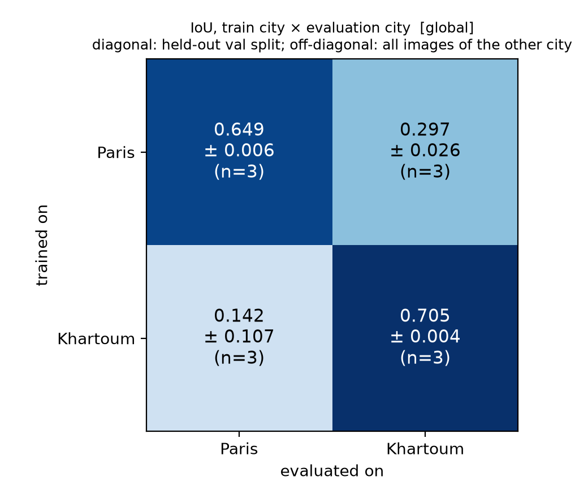
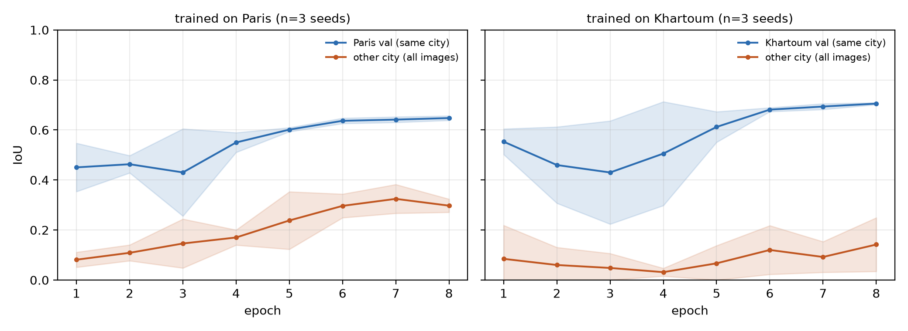

# Cross-city building segmentation

How well does a U-Net that segments buildings in one city work in another?
This repo trains a U-Net on **SpaceNet-2** satellite tiles of **Paris** and
**Khartoum**, measures in-city vs. cross-city IoU over several seeds, and provides
tools to diagnose *why* performance drops (calibration, normalization, few-shot adaptation).

> **Status.** The two-city transfer experiment (2 cities x 3 seeds) is done and
> summarized below; all raw per-run results are in `results/runs/`. The threshold-sweep
> diagnosis and the few-shot adaptation experiment are implemented and tested on
> synthetic data but **have not been run on the real data yet**, so this README makes
> no claims about them.

## Questions

1. How much IoU is lost when a model trained on one city is applied to the other (both directions)?
2. Is the loss a calibration problem (the model's probabilities shift) or a loss of ranking ability?
3. Can per-image normalization or brightness augmentation close the gap? (exploratory so far)
4. How many labelled images from the new city are needed to recover, and does starting from the source-city model beat starting from ImageNet alone? (implemented, not run yet)

## Data

SpaceNet-2 (building footprints), Paris (`AOI_3`, 1148 tiles) and Khartoum
(`AOI_5`, 1012 tiles). Each tile is 650x650, 3-band `uint16` pan-sharpened RGB with
a GeoJSON of building polygons. Both are on a public S3 bucket, no AWS account
needed (about 5.3 GB in total):

```bash
pip install awscli
bash scripts/download_data.sh data        # -> data/AOI_3_Paris, data/AOI_5_Khartoum
```

Building pixels make up **7.3% of Paris** and **15.8% of Khartoum** val-split pixels
(6.9% / 16.3% over all tiles), so the two cities also differ in class balance.
Check the SpaceNet dataset page for its licence terms. The data is not part of this repo.

## Quick start

```bash
pip install -r requirements.txt
python -m pytest -q tests                  # ~15 s, synthetic data, no GPU or download needed

# one run: train on Paris, evaluate on Paris val and on all of Khartoum
python scripts/train.py --train-city paris --seed 0

# the whole grid: training, threshold sweeps, few-shot, figures (resumable)
bash scripts/run_all.sh
```

On Google Colab:

```python
!git clone https://github.com/<your-user>/cross-city-building-segmentation
%cd cross-city-building-segmentation
!pip install -q -r requirements.txt
!bash scripts/download_data.sh /content/data
# put checkpoints on Drive so a disconnect does not lose them (mount Drive first)
!DATA=/content/data OUT=/content/drive/MyDrive/ccbs_runs bash scripts/run_all.sh
```

One 8-epoch run took 20-35 minutes on a Colab T4 (135-250 s per epoch depending on the
session, including the per-epoch evaluation on the other city). Training is resumable:
re-running a command continues from `last.pt`.

### Scripts

| script | purpose |
|---|---|
| `scripts/train.py` | train on one city; evaluate on same-city val and on the other city; writes `result.json` |
| `scripts/evaluate.py` | evaluate a checkpoint on any city/split; `--sweep` adds an IoU-vs-threshold sweep |
| `scripts/run_sweeps.sh` | threshold sweep of every checkpoint on the other city |
| `scripts/few_shot.py` | fine-tune on N target-city images (source init or ImageNet-only control) |
| `scripts/visualize.py` | image / truth / probability / error map for random tiles |
| `scripts/make_figures.py` | aggregate `results/` into figures and `results/summary.md` |
| `scripts/run_all.sh` | the full experiment grid |

Useful flags for `train.py`: `--norm {global,zscore}`, `--aug-brightness`, `--epochs`, `--seed`, `--no-pretrained` (offline), `--max-images` (quick tests).

## Method

- **Input.** `clip(x / 2000, 0, 1)` (a fixed constant for all images; raw values peak around 1800). The `zscore` variant standardizes each channel of each image, ignoring all-zero no-data pixels.
- **Masks.** GeoJSON polygons are reprojected from lon/lat to the image CRS and rasterized onto the image grid (`rasterio`). An empty GeoJSON gives an all-zero mask.
- **Model.** `segmentation_models_pytorch.Unet` with a ResNet-34 encoder (ImageNet weights), 1 output logit per pixel.
- **Loss.** BCE + Dice on logits. Buildings are a minority of pixels, so Dice keeps the model from settling on "mostly background".
- **Training.** Adam, lr 1e-3, cosine decay, batch size 4, 8 epochs, random horizontal/vertical flips (applied per batch).
- **Splits.** Fixed random 80/20 split of each city (seed 42), *independent of the training seed*, so seed-to-seed variation reflects training noise only. Paris: 919 train / 229 val. Khartoum: 810 train / 202 val.
- **Model selection.** Best epoch by **same-city** validation IoU. The other city is monitored every epoch for reporting only and never used to choose a checkpoint.
- **Metrics.** Dataset-level IoU, precision and recall (pixel counts summed over the whole set, then divided), plus predicted vs. true building fraction, at threshold 0.5. Averaging per-image IoU would let empty tiles dominate.
- **Cross-city number.** Evaluated on *all* images of the other city (none were used for training).
- **Few-shot.** Fine-tune on N random images from the target city's train split, then evaluate on its val split. The source-trained model and the ImageNet-only control use the **same** learning rate and number of epochs.

## Results: two-city transfer (3 seeds)

8 epochs, global normalization, ImageNet-initialized ResNet-34 U-Net, mean ± std over seeds 0-2
(Tesla T4). Full tables: [`results/summary.md`](results/summary.md); raw runs: `results/runs/`.

| trained on | IoU, same city (val split) | IoU, other city (all tiles) |
|---|---|---|
| Paris | 0.649 ± 0.006 | 0.297 ± 0.026 |
| Khartoum | 0.705 ± 0.004 | 0.142 ± 0.107 |




Per-run numbers, which the averages hide (`pred / true` = fraction of the other city's pixels
predicted / labelled as building at threshold 0.5):

| run | IoU same city | IoU other city | precision | recall | other city: pred / true |
|---|---|---|---|---|---|
| paris, seed 0 | 0.643 | 0.267 | 0.364 | 0.500 | 0.224 / 0.163 |
| paris, seed 1 | 0.653 | 0.313 | 0.349 | 0.753 | 0.352 / 0.163 |
| paris, seed 2 | 0.653 | 0.312 | 0.595 | 0.396 | 0.108 / 0.163 |
| khartoum, seed 0 | 0.701 | 0.042 | 0.724 | 0.043 | 0.004 / 0.069 |
| khartoum, seed 1 | 0.708 | 0.128 | 0.635 | 0.138 | 0.015 / 0.069 |
| khartoum, seed 2 | 0.707 | 0.256 | 0.313 | 0.584 | 0.129 / 0.069 |

What the data show:

- **Same-city IoU is stable** across seeds (std <= 0.006) and the models are well calibrated there (e.g. Khartoum val: 17.1% of pixels predicted vs. 15.8% true).
- **Cross-city IoU is much lower**: 0.649 -> 0.297 (Paris to Khartoum) and 0.705 -> 0.142 (Khartoum to Paris).
- **Cross-city results are unstable in a specific way.** At threshold 0.5 the *amount* of building the model predicts on the new city varies enormously between seeds: a Khartoum-trained model labels 0.4%, 1.5% or 12.9% of Paris pixels as building (true: 6.9%), with IoU 0.04, 0.13 and 0.26. A single IoU at a fixed threshold therefore mixes two things, how well pixels are *ranked* and how well the probabilities are *calibrated* on the new city. Which one dominates is an open question here. `scripts/run_sweeps.sh` is the planned test (IoU vs. threshold per model); it has not been run yet.
- **Direction asymmetry is only suggestive.** Paris to Khartoum (0.267-0.313) looks better than Khartoum to Paris (0.042-0.256), but with three seeds the ranges nearly touch (0.267 vs. 0.256).
- **The other-city score of a single run is noisy from epoch to epoch** (see the curves), so choosing the epoch by same-city validation IoU does not control cross-city quality.
- The two cities also differ in class balance (7% vs. 16% building pixels), so part of the shift is a change in label prior, not only in appearance. This repo does not separate the two.

### Reproducibility note

Seeds do not make GPU runs bit-exact. In a repeated run of the same commands (console logs, not archived in
`results/`) the same seed gave the same same-city IoU to within 0.002 but different other-city IoU:
Paris seed 0: 0.267 vs. 0.242; Khartoum seed 0: 0.042 vs. 0.046; Khartoum seed 1: 0.128 vs. 0.077.
So differences of a few IoU points on the other city are within run-to-run noise.

## Exploratory notebook results (single unseeded runs)

From the original Colab notebook; details and provenance in [`results/notebook_runs.json`](results/notebook_runs.json).
These used a different setup (the 5-epoch baseline had no learning-rate decay), so they are **not comparable**
to the table above.

| run | Paris val IoU | Khartoum IoU |
|---|---|---|
| Paris-trained, global norm, 5 epochs | 0.501 | 0.360 |
| Paris-trained, per-image z-score | 0.649 | 0.257 |

Qualitative observations from the notebook, not re-verified with seeds: test-time brightness matching and
brightness augmentation did not improve Khartoum IoU (the brightness-augmented model produced near-empty
predictions there), and z-score normalization raised same-city IoU without helping transfer. `--norm zscore`
and `--aug-brightness` are implemented in `scripts/train.py` to repeat these with seeds.

## Limitations

- **Spatial leakage in the in-city split.** Tiles are cut from larger scenes, so a random train/val split puts adjacent tiles of the same area on both sides. Same-city val IoU is therefore probably optimistic. Cross-city IoU is not affected, but the *gap* may be overstated.
- **Two cities, one sensor, one resolution.** Nothing here says how the findings carry over to other cities, sensors or ground sampling distances.
- **Three seeds.** Enough to see that cross-city IoU is unstable, not enough for tight confidence intervals or for the direction asymmetry. Run-to-run GPU nondeterminism (above) adds noise on top of seed variation.
- **Fixed threshold 0.5** for all reported IoUs. See the calibration point above; the oracle best-threshold numbers produced by `evaluate.py --sweep` use evaluation labels and are diagnostic only.
- **Single architecture and hyper-parameters.** No per-city tuning; early epochs show same-city validation spikes in some runs (e.g. Khartoum seed 2, epochs 3-4), possibly from BatchNorm at batch size 4 (a guess, untested).
- **Notebook few-shot control.** In the exploratory notebook the ImageNet-only control used a different learning rate from the fine-tuned model. The scripts here use matched settings by default.
- **Footprint quality.** Label noise and misalignment in SpaceNet are not modelled.

## Repository layout

```
src/ccbs/         data.py  model.py  losses.py  metrics.py  train.py  utils.py
scripts/          train.py  evaluate.py  few_shot.py  visualize.py  make_figures.py
                  run_all.sh  run_sweeps.sh  download_data.sh
tests/            unit tests + synthetic SpaceNet-like data generator
results/          runs/*.json (per-run results), summary.md (generated), notebook_runs.json (exploratory)
figures/          generated plots
notebooks/        the original exploratory Colab notebook (add it here)
```

## Next steps

- Run `scripts/run_sweeps.sh` (inference only, a few minutes on a GPU) to separate calibration from ranking quality; view tiles with `scripts/visualize.py`.
- Run the few-shot experiment (`scripts/run_all.sh` does it) and compare source-trained vs. ImageNet-only initialization.
- Repeat `--norm zscore` and `--aug-brightness` with three seeds.
- Spatially blocked in-city splits, to remove the leakage described above.
- Stronger adaptation baselines (colour-statistics transfer, self-training on unlabelled target tiles, feature-level domain adaptation).

## References

- Van Etten, Lindenbaum, Bacastow. *SpaceNet: A Remote Sensing Dataset and Challenge Series.* arXiv:1807.01232.
- Ronneberger, Fischer, Brox. *U-Net: Convolutional Networks for Biomedical Image Segmentation.* arXiv:1505.04597.
- `segmentation_models_pytorch`: https://github.com/qubvel-org/segmentation_models.pytorch

## License

Code: MIT (see `LICENSE`; replace the copyright holder placeholder with your name). SpaceNet data has its own licence.
