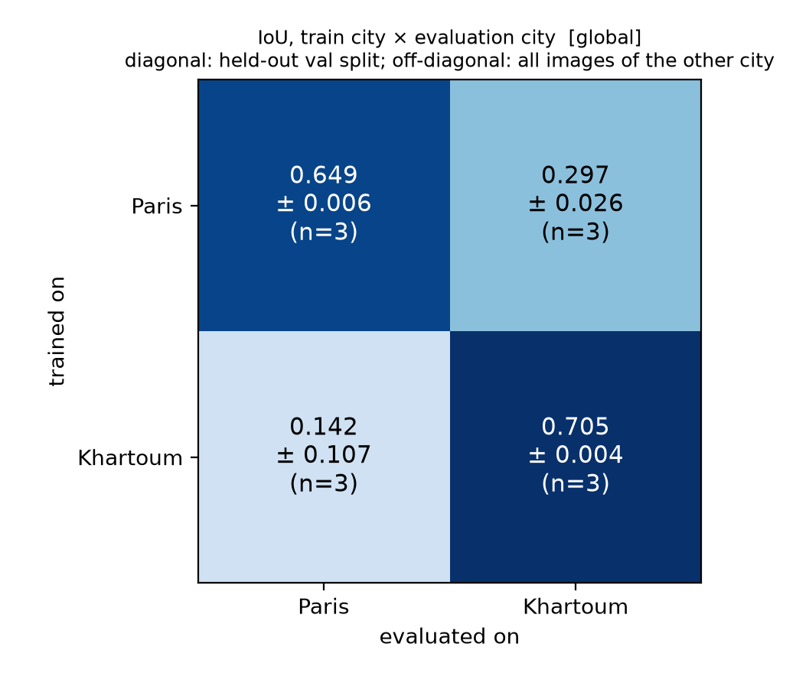
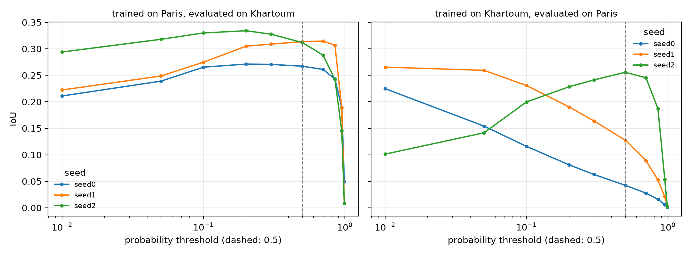
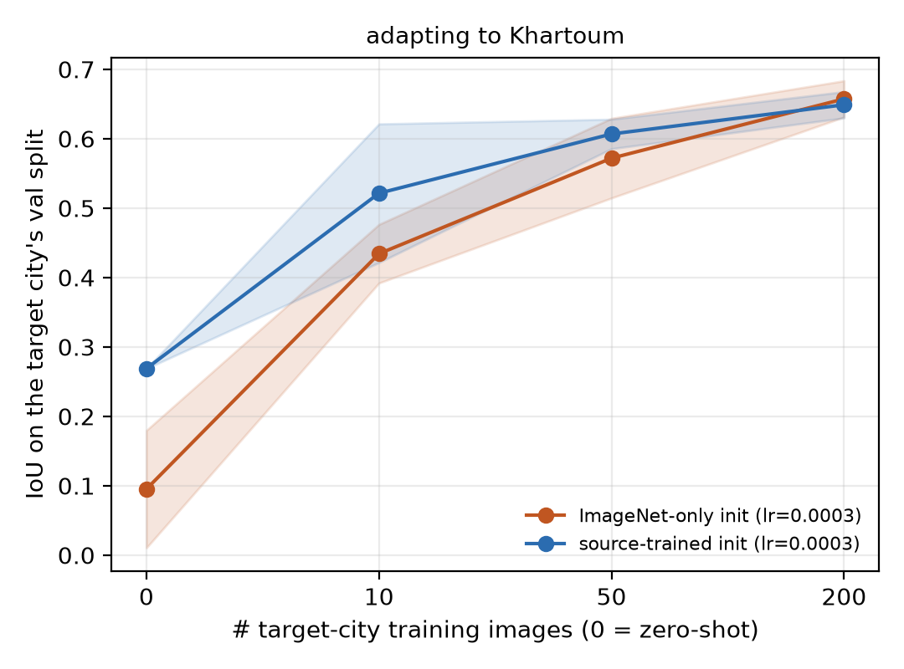

# Cross-City Building Segmentation: Paris and Khartoum

Mohammed Nasser Salem Mijo · November 2026 · [mmyjw48-web](https://github.com/mmyjw48-web)

## Summary

A U-Net trained to segment buildings in one city loses more than half of its accuracy in another city. Trained on Paris, it reaches IoU 0.649 ± 0.006 on held-out Paris tiles but 0.297 ± 0.026 on Khartoum. Trained on Khartoum, it reaches 0.705 ± 0.004 at home but 0.142 ± 0.107 on Paris (mean ± standard deviation over 3 seeds).

Two follow-up experiments explain part of the gap:

- **The two directions fail differently.** Paris → Khartoum is not a threshold problem: the best possible threshold raises mean IoU only from 0.297 to 0.307. Khartoum → Paris is largely a calibration problem: the best threshold raises it from 0.142 to 0.249, but that is still far below 0.705.
- **A few labelled target images recover most of the loss.** Fine-tuning the Paris model on 10 Khartoum images raises IoU on the Khartoum validation split from 0.269 to 0.521 ± 0.100, and on 200 images to 0.649 ± 0.019.
- **Starting from the source-city model helps only with very little data, and the evidence is weak.** At 200 images an ImageNet-only start does equally well (0.657 ± 0.026).

All numbers come from three seeds on two cities with a random in-city split, so they describe a trend, not a settled effect. The limits are listed in the Limitations section.

## 1. Question

How well does a building-segmentation model trained in one city work in another city? Building maps from satellite images are most needed where labels are scarce, so a model is usually trained where labels exist and applied elsewhere. This project measures that drop on one pair of very different cities, asks whether the drop is a matter of calibration or of the features themselves, and measures how many labelled images from the new city are needed to recover.

## 2. Data and method

**Data.** SpaceNet-2 pan-sharpened RGB tiles for Paris (AOI_3, 1,148 tiles) and Khartoum (AOI_5, 1,012 tiles). Each city is split once into 80% training and 20% validation tiles at random (split seed 42): 919 / 229 for Paris and 810 / 202 for Khartoum. Inputs are scaled with one fixed constant for every image, clip(x / 2000, 0, 1).

The cities differ in how much of the image is building, not only in appearance. Building pixels are 7.3% of the Paris validation split and 15.8% of the Khartoum validation split, so the label prior shifts by about a factor of two.

**Model and training.** A U-Net with a ResNet-34 encoder pretrained on ImageNet (`segmentation_models_pytorch`), one output channel. The loss is binary cross-entropy plus Dice. Training uses Adam at learning rate 1e-3 with cosine decay, batch size 4, 8 epochs, and random horizontal and vertical flips. Each city is trained with seeds 0, 1 and 2 on a Tesla T4, which gives 6 models.

**Evaluation.** The metric is dataset-level IoU of the building class: pixel counts are summed over all evaluation tiles and the ratio is taken once. The checkpoint is the epoch with the best same-city validation IoU, so no other-city labels are used for model selection. Predictions use a probability threshold of 0.5 unless stated otherwise. Same-city IoU is measured on that city's validation split; other-city IoU is measured on all tiles of the other city.

## 3. Result 1: accuracy drops sharply in the other city

Both models lose more than half of their IoU when moved, and the Khartoum-trained model is also unstable across seeds.

| Trained on | IoU, same city (validation split) | IoU, other city (all tiles) |
| --- | --- | --- |
| Paris | 0.649 ± 0.006 | 0.297 ± 0.026 (on Khartoum) |
| Khartoum | 0.705 ± 0.004 | 0.142 ± 0.107 (on Paris) |

Mean ± standard deviation over 3 training seeds, threshold 0.5.

The Khartoum → Paris number hides a wide spread: the three seeds give 0.042, 0.128 and 0.256. The same three models agree to within 0.01 on Khartoum itself (0.701, 0.708, 0.707). Models that look identical in their own city can therefore behave very differently elsewhere.

The per-seed precision and recall show what goes wrong. On Paris, the Khartoum seed-0 model marks only 0.4% of pixels as building while 6.9% truly are (precision 0.72, recall 0.04). It is nearly silent, not wrong about what it does predict. That observation motivates the threshold experiment below.

## 4. Result 2: the two directions fail for different reasons

Changing the decision threshold barely helps Paris → Khartoum but removes most of the seed instability in Khartoum → Paris. Each model was evaluated on all tiles of the other city at ten thresholds from 0.01 to 0.99, on an A100.

| Direction | Seed | IoU at 0.5 | Best threshold | IoU at best threshold |
| --- | --- | --- | --- | --- |
| Paris → Khartoum | 0 | 0.267 | 0.2 | 0.271 |
| Paris → Khartoum | 1 | 0.313 | 0.7 | 0.315 |
| Paris → Khartoum | 2 | 0.312 | 0.2 | 0.334 |
| Paris → Khartoum | mean | 0.297 |  | 0.307 |
| Khartoum → Paris | 0 | 0.042 | 0.01 | 0.225 |
| Khartoum → Paris | 1 | 0.127 | 0.01 | 0.265 |
| Khartoum → Paris | 2 | 0.256 | 0.5 | 0.256 |
| Khartoum → Paris | mean | 0.142 |  | 0.249 ± 0.021 |

**The best threshold is an oracle.** It is chosen with the evaluation labels, so these numbers diagnose the failure. They are not results a deployed model could reach.

- **Paris → Khartoum: the threshold is not the problem.** The best threshold adds 0.01 on average. The model ranks Khartoum pixels poorly, which points to the features, not to calibration.
- **Khartoum → Paris: mostly calibration, with a low ceiling.** With the best threshold the three seeds move from 0.042–0.256 to 0.225–0.265, so most of the instability comes from shifted probabilities. The ceiling is still about 0.25, against 0.705 in Khartoum itself.
- **The true optimum may be lower.** Two of the three best thresholds are 0.01, the lowest value in the grid.

The seed-1 value here is 0.127, against 0.128 in the first table. The two come from separate evaluation runs of the same checkpoint (0.1275 and 0.1276).

## 5. Result 3: a few target images recover most of the loss

Ten labelled Khartoum images raise the Paris model from 0.269 to 0.521, and 200 images bring it to 0.649. The Paris seed-0 checkpoint was fine-tuned on N Khartoum training images for 10 epochs (learning rate 3e-4, batch size 4) and compared with a control that starts from ImageNet weights only. Both starts use the same N images for a given seed. IoU is measured on the Khartoum validation split, on an A100.

| N Khartoum images | Start from Paris model | Start from ImageNet only |
| --- | --- | --- |
| 0 | 0.269 (one checkpoint) | 0.095 (not a baseline) |
| 10 | 0.521 ± 0.100 | 0.434 ± 0.042 |
| 50 | 0.607 ± 0.021 | 0.572 ± 0.057 |
| 200 | 0.649 ± 0.019 | 0.657 ± 0.026 |

Mean ± standard deviation over 3 seeds. The seed controls which images are drawn and the fine-tuning randomness.

- **The Paris start helps mainly at N = 10, and not reliably.** It is ahead by 0.087 on average but behind in one of three seeds (0.409 against 0.473). The standard deviations overlap.
- **At N = 200 there is no difference.** The two starts are within 0.008 of each other, well inside the seed spread.
- **The ImageNet-only value at N = 0 is not a baseline.** Its decoder is random and untrained, so the three seeds give 0.166, 0.002 and 0.118. It only completes the table.

For scale, models trained on all 810 Khartoum training images reach 0.705 ± 0.004. That run uses a different schedule, so it is a rough yardstick only.

## 6. Limitations

These results are a small, careful first measurement, and each point below limits what can be concluded.

- **Random in-city split.** Tiles are split at random, so neighbouring tiles can fall on both sides. There is probably spatial leakage, and same-city IoU is optimistic. The true cross-city gap is likely smaller than the tables suggest.
- **Only 3 seeds.** Standard deviations from three runs are rough, and several comparisons here overlap within them.
- **GPU runs are not bit-exact.** Rerunning the same seed changed other-city IoU by up to about 0.05 (Khartoum seed 1: 0.128 against 0.077), while same-city IoU stayed within 0.002. The rerun values come from console logs and are not archived in the repository. Differences of a few IoU points on the other city are within run-to-run noise.
- **Oracle thresholds.** The best thresholds in Section 4 use the evaluation labels and are diagnostic only.
- **Few-shot design.** One direction only (Paris → Khartoum) and one source checkpoint (Paris seed 0). Epochs are fixed at 10, so the number of gradient steps grows with N (30, 130 and 500). The learning rate was not tuned separately for each start, which may favour one of them.
- **Narrow scope.** Two cities, one sensor, one resolution. Nothing here shows that the pattern holds for other city pairs.
- **No ablations yet.** The report does not separate appearance shift from the label-prior shift (7.3% against 15.8% building pixels).

## 7. Next steps

Each planned experiment answers one of the limitations above.

- **A spatially blocked split**, to remove the leakage and get an honest same-city number.
- **Few-shot in the other direction** (Khartoum → Paris), with a learning-rate sweep for the ImageNet-only control.
- **Choosing the threshold without target labels**, for example by matching the predicted building fraction, to turn the Khartoum → Paris diagnosis into a usable method.
- **Normalization and brightness ablations** with 3 seeds, to test how much of the gap is input statistics.
- **Qualitative figures** of predictions in both cities.

## Reproducibility

Code, tests and every number in this report are in the public repository [mmyjw48-web/cross-city-building-segmentation](https://github.com/mmyjw48-web/cross-city-building-segmentation). The numbers are those of commit `7bdfdbc`. The training and few-shot results are in `results/runs/*.json`, the threshold sweeps in `results/sweeps/*.json`, and the plots in `figures/`. All numbers above were recomputed from those files; standard deviations are sample standard deviations (n − 1).
